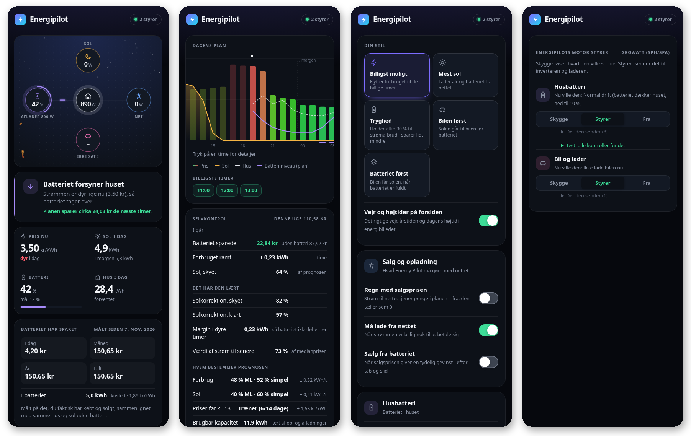
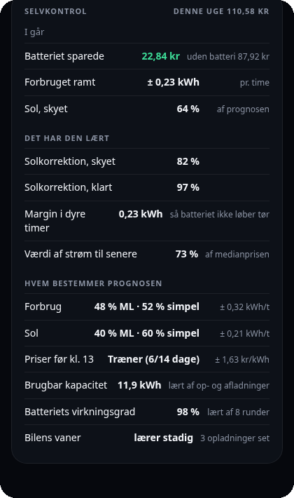
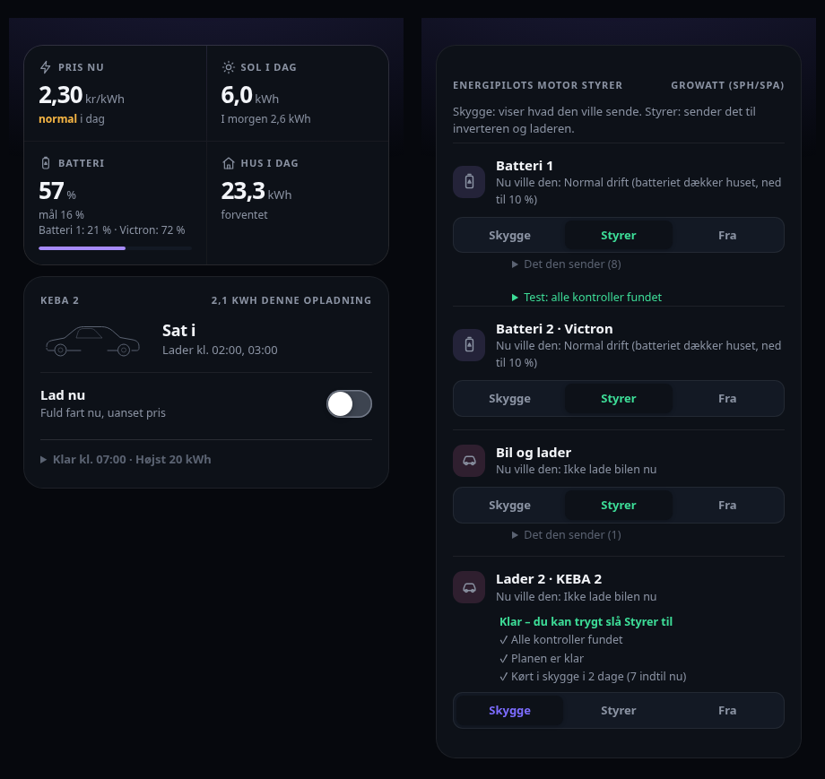
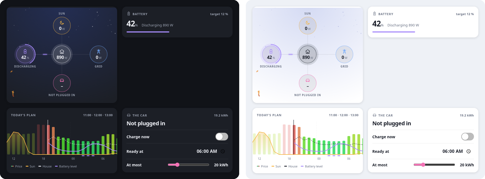

# ⚡ Energipilot

**Husbatteri, solceller og elbil – planlagt til den laveste pris.** 
Én app til Home Assistant, der selv finder dine ting, lærer dit hjem og bliver bedre hver nat.

[Installation](#installation) · [Funktioner](#funktioner) · [Dashboard-kort](#dashboard-kort) · [Mærker](#mærker) · [Spørgsmål](#spørgsmål) · 🇬🇧 [English](README.md)

> [!TIP]
> **🧪 Vi søger betatestere.** Alle opsætninger tæller – kun en lader, kun solceller, eller batteri + sol + bil. Især
> folk med andre invertere og ladere end mine. [Opret et issue](https://github.com/Clahen86/Energy-pilot/issues) og
> fortæl, hvad du har.

## Hvorfor Energipilot

| | |
|---|---|
| 🔍 **Sat op på to minutter** | Den finder selv sol, batteri, net, hus, bil og priser. Ingen YAML, ingen skabeloner. |
| 👻 **Sikker fra start** | Den starter altid i *skygge*: den viser, hvad den ville gøre, men styrer intet, før du siger til. |
| 🧠 **Lærer dit hjem** | En simpel prognose fra dag ét, og ML-modeller trænet hver nat på dine egne data overtager, når de rammer bedre. |
| ⏱️ **Planlægger i kvarterer** | Bruger markedets egne perioder, så de billigste kvarterer bliver brugt. |
| 💰 **Viser, hvad den sparede** | Målt på det, du faktisk købte og solgte, mod samme hus og sol uden batteriet. |
| 🔒 **Bliver hjemme** | Kører på en Raspberry Pi ved siden af Home Assistant. Ingen cloud, intet abonnement, ingen telemetri. |

## Installation

**Home Assistant OS / Supervised**

1. *Indstillinger → Apps → Butik → ⋮ → Repositories* → tilføj `https://github.com/Clahen86/Energy-pilot`
2. Installér **Energipilot**, og start den. Den kommer i sidepanelet.
3. Guiden viser, hvad den fandt. Ret det, der er forkert, og tryk **Kom i gang**.
4. Genstart Home Assistant én gang. Så kommer *Energipilot* under *Enheder og tjenester* med knapper og sensorer.

**Docker (Home Assistant Container/Core):** se [`docker/docker-compose.yml`](docker/docker-compose.yml). Giv den din
Home Assistant-adresse og et langtidsadgangstoken, og åbn `http://<vært>:8099`.

## Sådan virker den

1. **Finder det, du har** – og viser kun det. Intet batteri? Ingen batterisider.
2. **Lægger en plan** for i dag og i morgen – hvornår batteriet skal lade, hvornår det skal bruges, hvornår bilen skal lade.
3. **Kører i skygge** ved siden af det, du bruger i dag, og viser, hvad den ville sende til inverter og lader.
4. **Lærer hver nat** af det, der faktisk skete.
5. **Du slår den til** del for del – batteri, bil – når du stoler på den. Ét tryk sætter alt tilbage i skygge.

## Funktioner

### 🔋 Husbatteri
- Lader, når strømmen er billig eller solen giver for meget, og dækker huset, når strømmen er dyr.
- **Sælger fra batteriet, når det betaler sig** (valgfrit) – efter tab, slid og eksportgrænse. Kan springe de billige timer over.
- **Mål for batteriet** – "mindst 80 % kl. 7", hver dag.
- **Regner sliddet med** – finder batteritypen (LFP, NMC, natrium, bly) og bruger aldrig batteriet for få øres gevinst.
- **Lærer batteriet at kende** – den rigtige brugbare kapacitet, virkningsgraden og hvordan det lader langsommere tæt på fuldt.
- **Aldrig en halv kommando** – mangler en kontrol, styrer den ikke og siger, hvad der mangler.
- **Holder sine indstillinger på plads** – og siger til, hvis Predbat eller en automation også ændrer batteriet.

### 🚗 Bil og lader
- **Følger solen** minut for minut (fra 6 A) og **passer på hovedsikringen**.
- **Klar kl.** – ladet i de billigste perioder inden.
- **To grænser** – fra nettet op til fx 80 % og gratis soloverskud op til 100 %.
- **Bilens eget batteri i %** fra bilens integration (Tesla, Kia/Hyundai, VW-gruppen, BMW, Polestar, Volvo …).
- **"100 % til næste tur"** – slår selv fra, når bilen kører.
- **Tælles aldrig to gange** – er bilen med i husets sensor, trækker den bilen fra.

### 🧠 Den lærer dit hjem

To slags prognoser side om side, og den bedste bestemmer:

- **Fra dag ét:** gennemsnittet for hver time og ugedag fra din egen historik, justeret for temperatur og helligdage.
- **Efterhånden:** ML-modeller for husets forbrug, solen (dine paneler, retning og skygge) og morgendagens priser, før
  de er ude. De får intet at sige de første tre uger, derefter en andel, der følger, hvor godt de rammer. Rammer de ved
  siden af – en ny varmepumpe, en ny bil – falder andelen igen af sig selv.
- **Lærer også:** solprognosens sædvanlige fejl på skyede og klare dage, en sikkerhedsmargin i de dyre timer og bilens vaner.

### 🏠 Inde i Home Assistant
- Et panel i sidepanelet på 7 sprog, lyst og mørkt – med det rigtige vejr, årstider og højtider i energibilledet.
- **Dashboard-kort** til energiflow, batteri, bil og plan.
- **Sensorer** til dine egne automationer: beslutningen nu, næste opladning af batteri og bil, næste salg, **billigste
  time** (start opvaskeren der), hvad batteriet har sparet, og hvad strømmen i det kostede.
- **Knapper og kontakter:** *Lad nu*, *Klar kl.* og *Batteri-/Bil-styring* (Skygge / Styrer / Fra).
- **Et indstillingstjek**, der forklarer med almindelige ord, når en indstilling ødelægger planen – med et tryk til at rette den.

<b>Mere – flere batterier og ladere, off-grid, effekttarif, særlige opsætninger</b>

- **Flere husbatterier** – fx SolarEdge og Victron: planlægges som ét, styres hver gennem sin egen inverter og sættes
  til at styre hver for sig.
- **Flere ladebokse** – hver bil har sin egen *lad nu*, *klar kl.* og *højst*, og tilsammen holdes de under hovedsikringen.

  

- **Ingen husforbrug-sensor nødvendig** – den regner huset ud fra net, sol, batteri og bil.
- **Enhver solprognose** – Solcast, Open-Meteo, Forecast.Solar … eller sin egen ud fra vejret og anlæggets historik.
- **Særlige opsætninger** – flere solanlæg lægges sammen, batteriets og nettets fortegn findes selv, og en skiftende
  salgspris kan komme fra en sensor eller din egen tarifplan (med daglig grænse).
- **Effekttarif** (Belgien, Norge, Sverige) – holder øje med månedens top og barberer den af med batteriet.
- **Off-grid** – generatoren bliver "nettet": den starter, før batteriet når reserven, kører længe ad gangen og altid ved nødgrænsen.
- **Din egen AppDaemon i skygge** – kører din nuværende opsætning uændret ved siden af og viser, hvor tit de er enige.

## Dashboard-kort

Tilføj dem fra kortvælgeren – søg efter *Energipilot*. De følger dit Home Assistant-tema.

## Det skal du bruge

| | |
|---|---|
| **Krav** | Home Assistant og en sensor for husets forbrug (W) – eller net- og solsensorer, så regner den huset ud |
| **Priser** | Intet – spotpriser for 26 europæiske lande er indbygget. Strømligning, Nord Pool, Tibber, Energi Data Service m.fl. bruges, hvis du har dem. |
| **Valgfrit** | Solceller, husbatteri, elbil-lader – en af dem, alle, eller ingen |

## Mærker

Alt går gennem enhedens egen Home Assistant-integration. 
✅ kører i rigtig brug · 🧪 bygget ud fra integrationens egen kode, venter på en betatester med udstyret

| | |
|---|---|
| **Inverter / batteri** | ✅ Growatt SPH (SPA) · 🧪 Growatt MIN/MOD TL-XH · 🧪 Deye (Solarman eller ESPHome) · 🧪 Sofar · 🧪 Sigenergy · 🧪 Tesla Powerwall · 🧪 Enphase IQ Battery · 🧪 Victron (ESS) · 🧪 EcoFlow PowerStream · 🧪 Megarevo · 🧪 Huawei · 🧪 SolaX · 🧪 Sungrow · 🧪 SolarEdge · 🧪 Fox ESS · 🧪 GivEnergy · 🧪 Solis · 🧪 Alpha ESS · alle andre ved at vælge kontrollerne selv |
| **Elbil-lader** | ✅ KEBA · 🧪 Easee · 🧪 Zaptec · 🧪 go-e · 🧪 Wallbox · 🧪 Peblar · 🧪 OCPP · 🧪 Alfen · 🧪 Ohme · 🧪 myenergi zappi · alle med en kontakt og en strømindstilling |
| **Priser** | ✅ Strømligning · ✅ indbyggede spotpriser · 🧪 Nord Pool · 🧪 Tibber · 🧪 Energi Data Service · 🧪 ENTSO-E · 🧪 Octopus · 🧪 Amber · 🧪 EDF Tempo · 🧪 EnergyZero · 🧪 easyEnergy · 🧪 Frank Energie · 🧪 Zonneplan · tarifplaner |

## Spørgsmål

<b>Kan den køre ved siden af det system, jeg bruger i dag?</b>

Ja – det er det, skygge er til. Den styrer aldrig en del, som et andet system styrer, medmindre du beder om det.

<b>Sender den data nogen steder hen?</b>

Nej. Alt kører hjemme hos dig, også ML-modellerne. Den henter kun offentlige data: vejr (Open-Meteo), spotpriser
(Energi Data Service, energy-charts.info) og valutakurser (ECB).

<b>Hvad hvis internettet går ned?</b>

Den planlægger videre med de priser og det vejr, den allerede har, og inverteren kører som normalt.

<b>Skal jeg have et batteri?</b>

Nej. Med kun solceller planlægger og viser den din dag. Med kun en lader lader den bilen i de billigste perioder.

<b>Noget ser forkert ud – hvad sender jeg?</b>

Tryk *Hent diagnosefil* under Indstillinger, og vedhæft filen i et
[issue](https://github.com/Clahen86/Energy-pilot/issues). Den indeholder ingen adgangskoder.

## Godt at vide

- 🧪-profilerne er ikke prøvet på rigtige anlæg endnu – kør dem i skygge først, tjek kontroltesten, og fortæl, hvordan det går.
- Sprog: dansk, engelsk, tysk, fransk, hollandsk, svensk og norsk – følger Home Assistants sprog.

MIT-licens.
