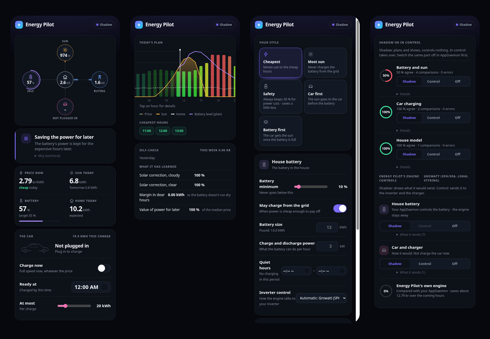
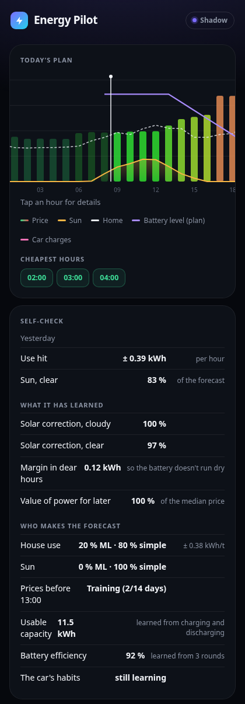
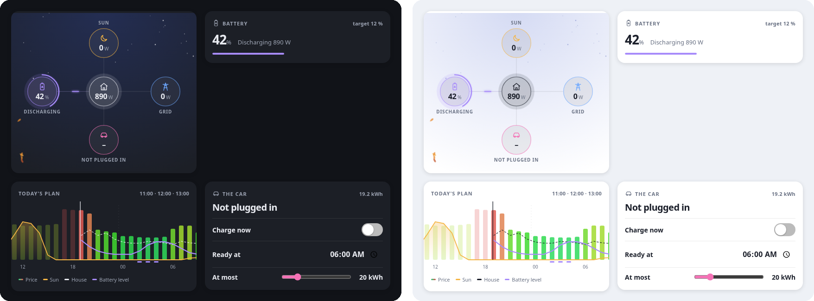
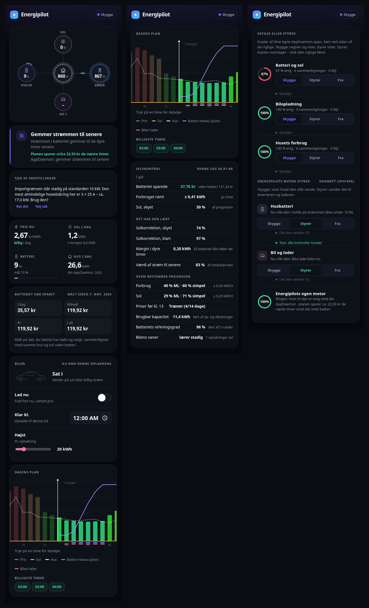

# Energipilot · Energy Pilot

**Your home battery, solar panels and electric car – planned for the lowest price, in one app for Home Assistant
that learns your home and gets better every night.** It always starts in *shadow*: it shows what it would do, but
controls nothing until you say so.

> 🧪 **Beta testers wanted.** Any setup counts – just an EV charger, just solar, or battery + solar + car. I especially
> need people with other inverters and chargers than mine. [Open an issue](https://github.com/Clahen86/Energy-pilot/issues)
> and tell me what you have.

## Set up in two minutes

1. Add the repository and install the app (see [Install](#install)).
2. Open **Energipilot** in the sidebar. It has already looked through your Home Assistant – the Energy dashboard,
   known integrations and sensor names – and shows what it found: solar, battery, grid, house, car, prices.
3. Fix anything that's wrong with a tap, and press **Get started**.

No YAML, no files to edit, no templates to write. Weather, spot prices for 26 European countries, a solar forecast and
holidays are built in, so it works even if you have nothing but a power sensor.

## How it works

1. **It finds what you have** and only shows that. No battery? No battery screens.
2. **It makes a plan** for today and tomorrow: when to charge the battery (cheap power or too much sun), when to use
   it (dear power), and when to charge the car (sun first, then the cheapest slots before it must be ready).
3. **It runs in shadow** next to whatever you use today and shows what it would send to your inverter and charger.
4. **It learns every night** from what really happened (see below).
5. **You switch it on** part by part – battery, car – when you trust it. One tap puts everything back in shadow.

## It learns your home

Most energy planners use a fixed formula. Energy Pilot uses two ways of forecasting side by side, and lets the better
one decide:

- **From day one:** a simple forecast – the average for each hour and weekday from your own history, adjusted for
  temperature and holidays. Good enough to start, so new users aren't waiting for a model to train.
- **As it earns it:** ML models trained every night on *your* data, in your home:
  - **house use** – hour, weekday, day off, temperature
  - **solar** – sunlight, cloud, temperature and time of year, so it learns your panels, their direction and shade
  - **tomorrow's prices before they're out** (around 13:00) – wind, sun, weekday and recent prices
- **Every night** both are checked against what really happened. The ML model's share moves towards what it has
  earned: nothing until it has three weeks of data, half when the two hit equally well, more when it's better. If it
  starts to miss – a new heat pump, a new car – its share goes down again by itself.
- **It also learns** how far off the solar forecast usually is on cloudy and clear days, a safety margin for the dear
  hours, the battery's real usable capacity and efficiency (labels often say more than what's usable, and batteries wear),
  and the car's habits (when it leaves, how much it takes). What you set
  yourself always wins.

The panel shows who decides right now and how well each one hits:

## What only Energy Pilot does

- **Simple and ML, blended by results** – works from day one and gets better on its own, instead of either a fixed
  formula or a model that needs months before it's useful.
- **Quarter-hour planning** – Europe's prices change every 15 minutes since October 2025. Energy Pilot plans in the
  market's own slots (quarter hours in Europe, half hours on UK Agile, hours elsewhere), so the battery and car use the
  cheapest quarters inside an hour.
- **What the battery really saved** – measured from what you bought and sold, against the same house and sun without
  the battery. And what the power in the battery cost (grid power at the price paid, solar free or at the sell price).
- **Never half a command** – if a control your inverter profile needs is missing, it won't control at all and tells you
  what's missing. A control test in *Shadow* shows every control it found.
- **The car is never counted twice** – if your house sensor includes the car, it notices from the hours the car charged
  and takes it out, so the house forecast and the battery plan stay right.
- **Runs your own system in shadow** – already have an energy setup in AppDaemon? Energy Pilot can run it unchanged next
  to its own engine and show how often they agree.
- **Lives inside Home Assistant** – a sidebar panel, dashboard cards, and buttons and sensors (*Charge now*, *Ready at*,
  *Saved today*, *Battery power cost* …) for your own automations.
- **Runs on a Raspberry Pi** – right next to Home Assistant, no cloud, no subscription. Even the ML models are trained
  at home, in a few seconds a night (about 180 MB RAM).
- **No telemetry** – nothing about you or your home ever leaves your house.

## What you need

| | |
|---|---|
| **Required** | Home Assistant, and a sensor for the house's power use (W) – most homes already have one |
| **Prices** | Nothing – spot prices for 26 European countries are built in. Strømligning, Nord Pool, Tibber, Octopus, Amber, EDF Tempo and many more are used if you have them. No spot price (USA, UK…)? Enter your tariff plan or start from a template. |
| **Optional** | Solar panels, a home battery, an EV charger – any of them, all of them, or none |

## Brands

Everything goes through the device's own Home Assistant integration. ✅ runs in real use · 🧪 built from the
integration's own source code (entity names and values checked), waiting for a beta tester with the hardware.

| | |
|---|---|
| **Inverter / battery** | ✅ Growatt SPH (SPA) · 🧪 Growatt MIN/MOD TL-XH · 🧪 Deye (Solarman or ESPHome/local Modbus) · 🧪 Sofar (Solarman or SolaX Modbus) · 🧪 Sigenergy · 🧪 Tesla Powerwall · 🧪 Enphase IQ Battery · 🧪 Victron (ESS) · 🧪 EcoFlow PowerStream · 🧪 Huawei SUN2000/LUNA2000 · 🧪 SolaX · 🧪 Sungrow · 🧪 SolarEdge · 🧪 Fox ESS · 🧪 GivEnergy · 🧪 Solis (Solis Modbus) · 🧪 Alpha ESS (cloud) · any other by picking its controls yourself |
| **EV charger** | ✅ KEBA · 🧪 Easee · 🧪 Zaptec · 🧪 go-e · 🧪 Wallbox · 🧪 Peblar · 🧪 OCPP · 🧪 Alfen · 🧪 Ohme · 🧪 myenergi zappi · any with a switch and a current setting |
| **Prices** | ✅ Strømligning · ✅ built-in spot prices · 🧪 Nord Pool (built-in and HACS) · 🧪 Tibber · 🧪 Energi Data Service · 🧪 ENTSO-E · 🧪 Octopus Energy (import + export, Agile) · 🧪 Amber · 🧪 EDF Tempo · 🧪 EnergyZero · 🧪 easyEnergy · 🧪 Frank Energie · 🧪 Zonneplan · tariff plans |

## Install

**Home Assistant OS / Supervised (recommended):**
1. *Settings → Apps → App store → ⋮ → Repositories* → add `https://github.com/Clahen86/Energy-pilot`
2. Install **Energipilot** and start it. It appears in the sidebar.
3. The guide shows what it found – fix what's wrong and press *Get started*.
4. Restart Home Assistant once: *Energipilot found* appears under *Devices & services* (buttons and sensors).

**Docker (Home Assistant Container/Core):** see [`docker/docker-compose.yml`](docker/docker-compose.yml) – give it your
Home Assistant address and a long-lived access token, open `http://<host>:8099`. Mount your Home Assistant config at
`/homeassistant` to get the cards and the companion integration installed automatically.

## FAQ

**Can it run next to the system I use today?** Yes – that's what shadow is for. It never controls a part another
system controls, and it never takes the battery while your own system plans it, unless you tell it to.

**Does it send any data?** No. Everything runs in your home, the ML models too. It only fetches public data: weather
(Open-Meteo), spot prices (Energi Data Service, energy-charts.info) and exchange rates (ECB via frankfurter.dev).

**What if the internet goes down?** It keeps planning with the prices and weather it already has, and your inverter
keeps running as normal.

**Do I need a battery?** No. With just solar it plans and shows your day; with just an EV charger it charges in the
cheapest slots.

**How good are the forecasts at first?** The simple forecast works from day one. The ML models need about three weeks
of data before they get a say, and only take over when they're better.

## Good to know

- The 🧪 profiles are built from each integration's known controls but not yet tried on real systems – run them in
  shadow first, check the control test, and tell me how it goes.
- Languages: English, Danish, German, French, Dutch, Swedish and Norwegian – it follows Home Assistant's language. Corrections from native speakers are very welcome.

---

## Dansk

**Husbatteri, solceller og elbil – planlagt til den laveste pris, i én app til Home Assistant, der lærer dit hjem og
bliver bedre hver nat.** Den starter altid i *skygge*: den viser, hvad den ville gøre, men styrer intet, før du siger til.

> 🧪 **Vi søger betatestere** – alle opsætninger tæller, også hvis du kun har en elbil-lader eller kun solceller.

- **Sat op på to minutter:** den finder selv dine ting i Home Assistant. Du trykker bare *Kom i gang* – ingen YAML.
- **Lærer dit hus:** en simpel prognose fra dag ét, og ML-modeller, der trænes hver nat på dine egne data, overtager
  efterhånden som de rammer bedre – for forbrug, sol og morgendagens priser før kl. 13. Rammer de ved siden af, tager den
  simple over igen.
- **Lærer batteriet at kende:** den rigtige brugbare kapacitet og virkningsgrad – navneværdien er ofte højere, og batterier slides.
- **Planlægger i kvarterer**, så batteri og bil bruger de billigste kvarterer.
- **Målt besparelse** og batteriets kostpris.
- **Aldrig en halv kommando:** mangler en kontrol, styrer den ikke, og en test i skygge viser, hvad den fandt.
- **Bilen tælles aldrig to gange**, og den kan køre din egen AppDaemon i skygge og sammenligne.
- **Kører på en Raspberry Pi** ved siden af Home Assistant – ingen cloud, intet abonnement.
- **Ingen telemetri** – intet forlader dit hjem.
- **Styrer mange mærker** – se tabellen ovenfor (✅ testet, 🧪 venter på en betatester).

**Installation:** *Indstillinger → Apps → Butik → ⋮ → Repositories* → tilføj
`https://github.com/Clahen86/Energy-pilot`, installér **Energipilot**, start den, og følg guiden.

MIT-licens.
