

# ⚡ Energy Pilot

**Your home battery, solar panels and electric car – planned for the lowest price.** 
One app for Home Assistant that finds what you have, learns your home and gets better every night.

[Install](#install) · [Features](#features) · [Dashboard cards](#dashboard-cards) · [Brands](#brands) · [FAQ](#faq) · 🇩🇰 [Dansk](README.da.md)

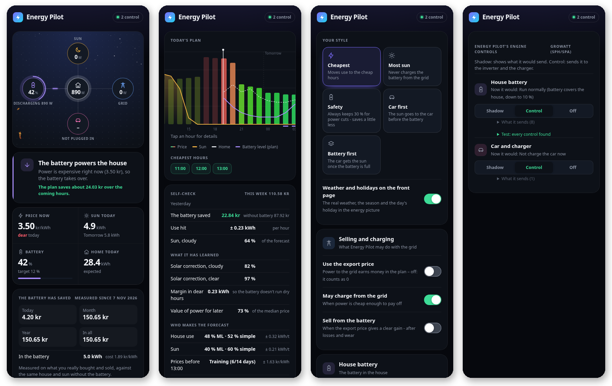

> [!TIP]
> **🧪 Beta testers wanted.** Any setup counts – just a charger, just solar, or battery + solar + car. I especially need
> people with other inverters and chargers than mine. [Open an issue](https://github.com/Clahen86/Energy-pilot/issues)
> and tell me what you have.

## Why Energy Pilot

| | |
|---|---|
| 🔍 **Set up in two minutes** | It finds your solar, battery, grid, house, car and prices by itself. No YAML, no templates. |
| 👻 **Safe from the start** | It always starts in *shadow*: it shows what it would do, but controls nothing until you say so. |
| 🧠 **Learns your home** | A simple forecast from day one, and ML models trained every night on your own data take over when they hit better. |
| ⏱️ **Plans in quarter hours** | Uses the market's own slots (15 min in Europe, 30 min on UK Agile), so the cheapest quarters are used. |
| 💰 **Shows what it saved** | Measured from what you really bought and sold, against the same house and sun without the battery. |
| 🔒 **Stays at home** | Runs on a Raspberry Pi next to Home Assistant. No cloud, no subscription – only a small anonymous daily line you can turn off. |

## Install

**Home Assistant OS / Supervised**

1. *Settings → Apps → App store → ⋮ → Repositories* → add `https://github.com/Clahen86/Energy-pilot`
2. Install **Energipilot** and start it. It appears in the sidebar.
3. The guide shows what it found. Fix anything that's wrong and press **Get started**.
   It then offers to **test your system** (about 10 minutes) – or skip it and test later.
4. Restart Home Assistant once. *Energipilot* then appears under *Devices & services* with buttons and sensors.

**Docker (Home Assistant Container/Core):** see [`docker/docker-compose.yml`](docker/docker-compose.yml). Give it your
Home Assistant address and a long-lived access token, and open `http://<host>:8099`. The panel asks for a password
(any user name): set your own with `EP_PASSWORD`, or use the one written to the log at the first start. Changes are
only taken as JSON from the panel itself, so another web page can't send them.

**What the add-on may reach:** its own folder, and your Home Assistant configuration folder – only to put the companion
integration in `custom_components/energy_pilot` and the dashboard card in `www/energipilot`. Install the companion from the
Marketplace (HACS) instead – [energy-pilot-companion](https://github.com/Clahen86/energy-pilot-companion) – and the add-on
leaves it alone and the integration serves the card; the access to the folder goes once most have moved. It talks to Home
Assistant through the Supervisor, like other add-ons, and only answers Home Assistant itself and its login (ingress).
Auto update is your choice – it only suggests it.

## How it works

1. **Finds what you have** – and only shows that. No battery? No battery screens.
2. **Makes a plan** for today and tomorrow – when to charge the battery, when to use it, when to charge the car.
3. **Runs in shadow** next to what you use today and shows what it would send to your inverter and charger.
4. **Tests your system** when you press the button – it checks that your inverter and charger really do what they're told.
5. **Learns every night** from what really happened.
6. **You switch it on** part by part – battery, car – when you trust it. One tap puts everything back in shadow.

## Features

### 🔋 Home battery
- Charges when power is cheap or the sun gives too much, and covers the house when power is dear.
- **Sells from the battery when it pays** (optional) – after losses, wear and your export limit. It can skip the cheap hours.
- **Battery targets** – "at least 80 % at 7:00", every day.
- **Counts the wear** – finds the battery type (LFP, NMC, sodium, lead) and never cycles it for a few cents. You choose how
  careful: *Spare the battery*, *In between* or *Most saved*.
- **Says why** – "For tomorrow 17–21 at up to 3.30 · now 2.15" when it holds the battery (with the efficiency it counts
  with), and "Storing the sun: worth up to 0.27 today 16–19 · selling now 0.19" when it keeps the sun instead of selling it.
- **Learns the battery** – its real usable capacity, efficiency and how it slows down near full.
- **Plans for an unsure sun** – when the forecast's poor day is far below what it expects (Solcast), it counts on a
  little less sun, so a cloudier day doesn't leave the battery short.
- **Charges gently** – when hours cost about the same, it spreads the charge at a calm power instead of full power in one.
- **Knows when nobody's home** – everyone away for a day (the people in Home Assistant): it plans for the house's
  standby use until someone is back.
- **A cold battery charges slower** – learned from its own temperature, and shown as a curve under *Plan*.
- **Keeps room for the sun** – it finds a limit on selling by itself and doesn't fill the battery with bought power
  before a sunny day the sun would otherwise be lost on.
- **Your own hours** – tap an hour in the plan and choose *Charge here*, *Sell here* or *Keep the power*. The plan
  plans the rest around it; *Automatic* gives the hour back.
- **Octopus Power Down sessions** (UK) are joined by themselves, and the battery keeps power for them.

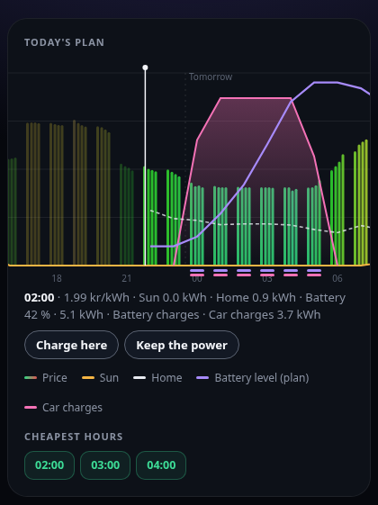 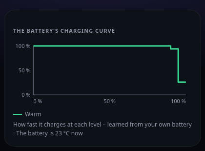

- **Never half a command** – if a control is missing, it doesn't control and tells you what's missing.
- **Keeps its settings in place** – and tells you if Predbat or an automation keeps changing the battery too.
- **How long the battery lasts** – "until 06:40" without the grid, worked out hour by hour from your house's expected
  use and the sun, with the plan's curve, the lowest level tonight and when it's full. On the home page, in the
  dashboard card and as a sensor for your own automations.
- **Storm watch** (off unless you turn it on) – a storm or thunder on its way, from the forecast or an official warning
  (Meteoalarm, DWD, Météo-France, Environment Canada, GDACS, NWS, BOM, MetService, MET, Met Office, NHC): the battery
  is filled up in the cheapest hours before and kept high until it's over, so the house has power if the grid goes down.

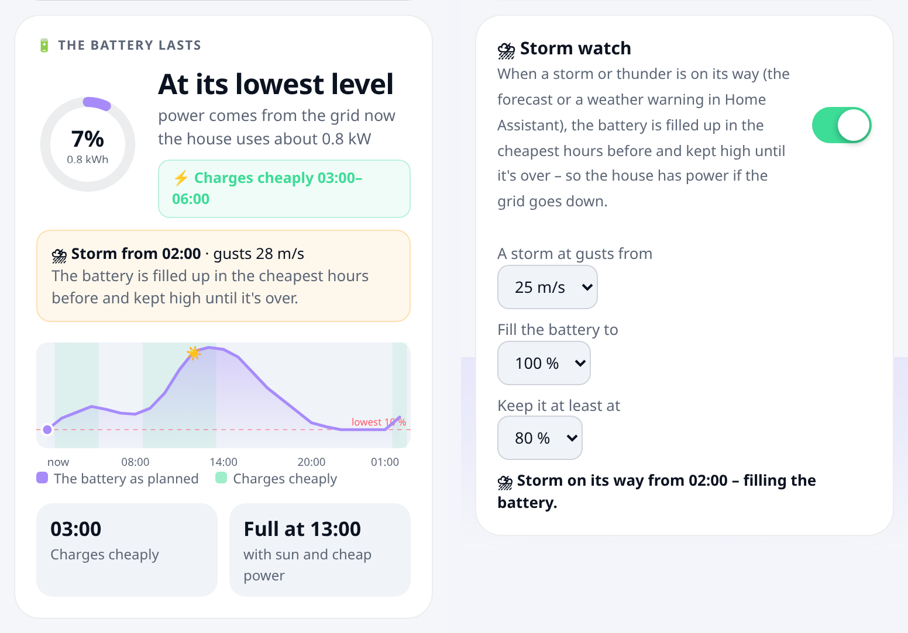

### ☀️ Stop selling at negative prices
- When selling would cost money, the inverter's **export limit is turned down** – the house and the battery still use
  all the sun, only the grid gets none. Afterwards your own setting is put back.
- **Off by default.** Turn it on under *Settings* and it picks the right setting from your inverter brand (Growatt:
  export limiter on and the limit at 0 %) – or choose another.
- **Test it**: it stops selling for up to 2 minutes, checks that the export really drops to 0 and puts everything back.
  If it doesn't work, you can send the diagnostics right there. Follows the battery's shadow/control.

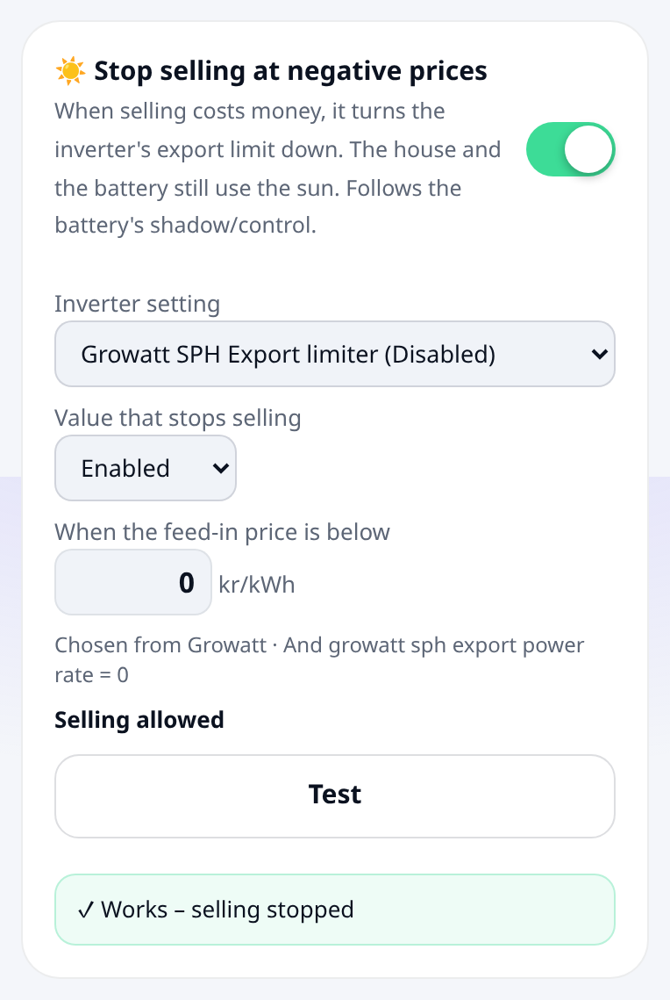

### 🚗 Car and charger
- **Follows the sun** minute by minute (6 A and up) and **never trips the main fuse**.
- **Ready at** a set time, charged in the cheapest slots before it.
- **Two limits** – from the grid up to, say, 80 %, and free solar surplus up to 100 %.
- **The car's own battery %** from its integration (Tesla, Kia/Hyundai, VW group, BMW, Polestar, Volvo …).
- **"100 % for the next trip"** – turns itself off when the car leaves.
- **Never counted twice** – if your house sensor includes the car, it takes it out.
- **The house battery and the car** – the car's charging is part of the battery plan: the battery only helps the car
  with power the house won't need before the sun or cheap power fills it again, and never on a dear evening. If the
  battery may not charge from the grid, a charger that can be turned down gives the battery the sun first.

### 🔌 Runs cheaply
Small batteries and machines on the sun or in the cheapest hours – **after** the house battery and the car.

- **Batteries** (robot mower, e-bike, tool batteries) on a smart plug: switched on in the best hours, off when the
  charger stops drawing power – full.
- **Machines** (washing machine, dryer, dishwasher): tap **▶ Ready** and it starts at the best time. Never switched off
  mid-programme. Without remote start it tells you when to press start.
- **One choice:** *Sun, else cheap*, *Sun only* or *Cheapest time* – plus an optional "done by".
- **Learns** how much and how long each thing takes, and **finds them by itself** – never phones, lights or the car.
- Only the sun that would otherwise be sold, and always within the main fuse.
- **Water heater** on a switch: found by itself, stays on and only rests in up to 4 dear hours a day – the water
  stays hot. Turn it on yourself and it stays on.

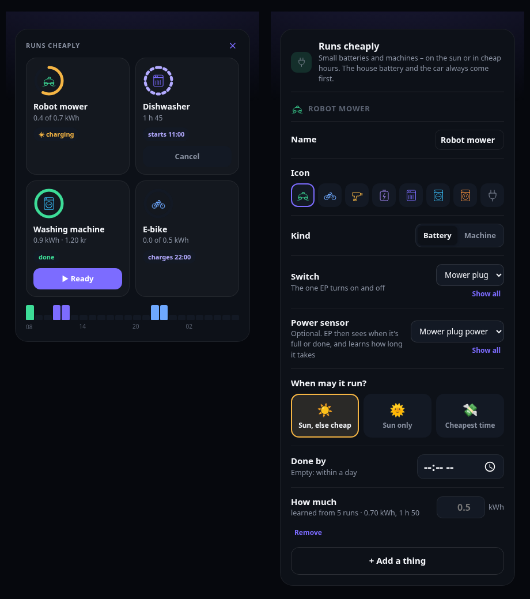

### 💡 What if, and which electricity deal
- **What if** – what a bigger battery, more panels or no battery would have meant, worked out on your own last 30 days
  with the same plan.
- **Electricity deals** – which deal would have been cheapest for *your* use, each with its own battery plan:
  every private deal in Denmark (elpris.dk), Octopus in the UK, every retailer at your postcode in Australia, Italy's
  open offers and your US utility's tariffs. Elsewhere: hourly price against fixed. Pick your own deal (under
  *Settings → Electricity price*) to see what you'd save. Hide it with ✕.

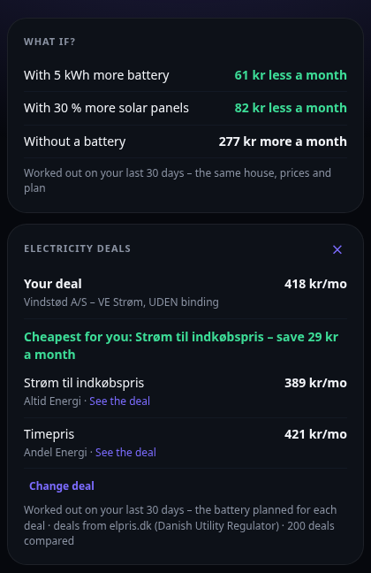

### 🧠 It learns your home

Two ways of forecasting side by side, and the better one decides:

- **From day one:** the average for each hour and weekday from your own history, adjusted for temperature and holidays.
- **As it earns it:** ML models for house use, solar (your panels, direction and shade) and tomorrow's prices before
  they're out. They get no say for the first three weeks, then a share that follows how well they hit. If they start
  to miss – a new heat pump, a new car – their share drops again by itself.
- **Also learned:** the solar forecast's usual error on cloudy and clear days, a safety margin for the dear hours, and
  the car's habits.
- **No statistics in Home Assistant?** If your house sensor has no `state_class`, it says so – and can keep the
  history itself with one tap.
- **Plan vs. actual:** under *Plan*, the Self-check card shows yesterday hour by hour – house, solar and battery,
  planned against what really happened – with how accurate the plan was in %. Tap an hour for its numbers.

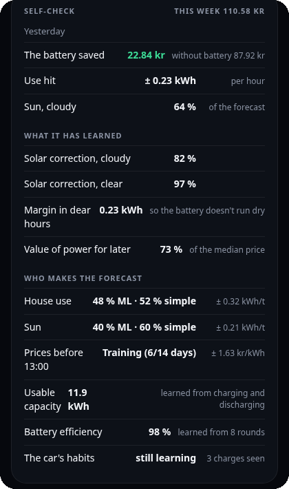 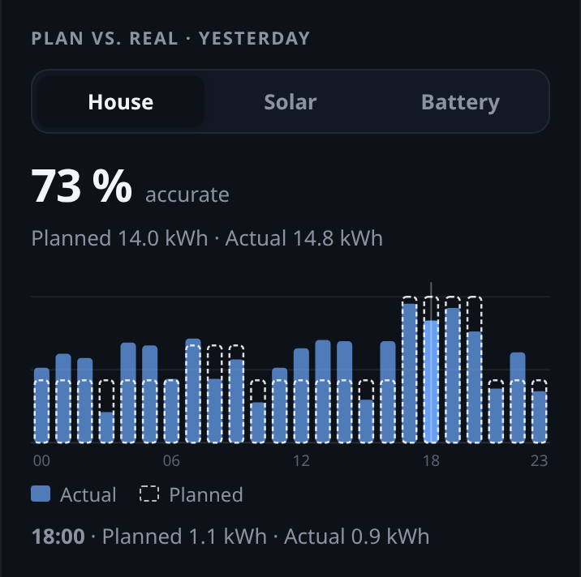

### 🛡️ Safe and easy
- **Test your system** – tries hold, charge and sell (and the charger if the car is plugged in) at most 1 kW for a
  couple of minutes each, and checks that the battery really does it. If a step fails, it tries the inverter's other
  safe options by itself and keeps the one that works (you can undo it). Everything is put back afterwards – also if
  Home Assistant restarts in the middle.
- **Get help** – on its own **Help** tab at the bottom: write what's wrong, attach up to 3 pictures and press *Send*. The test result and diagnostics go
  privately to the developer, and you get a reference number. You see exactly what is sent first.
- **Answers from the developer** – when the developer replies to your *Get help* (or to an error the app reported),
  the answer shows on the *Help* tab with a notification in Home Assistant. You can write back from there.
- **Fixes simple mistakes by itself**, shown as one line with an undo: a main fuse written in amps, a battery level
  given as 0–1, power in kW without a unit, a price in cents, a sensor that was renamed or stopped updating, a battery or
  solar sensor that stopped answering. A price taken from a select (Peak / Off Peak) is pointed out.
- **Tells you about updates – without nagging**: a small card in the app when a newer version is out – small fixes
  once you're a week behind, new features after two days, and at once when an error you had is fixed. *Later* hides it
  for a week. A notification in Home Assistant (never on the phone) only for your own error fixed, or an important fix.
- **A status light** at the top – green, yellow or red – with one tap to what needs attention.
- **Always the safe way:** a battery doing the opposite of what it's told goes back to normal for an hour with a
  warning; a charger that won't start is restarted once.

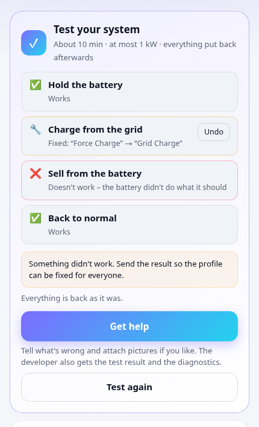 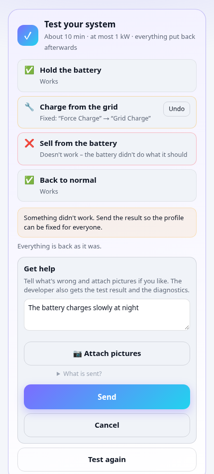

### 🏠 Inside Home Assistant
- A sidebar panel in 7 languages, in light and dark – with the real weather, seasons and holidays on the energy picture.
- **Dashboard cards** for the energy flow, battery, car and plan.
- **Quarter-hour prices** – planned and drawn in 15 or 30 minute slots when your price comes like that, not as the hour's average.
- **Sensors** for your own automations: the decision now, next battery charge, next car charge, next sale, **cheapest
  hour** (start the dishwasher then), what the battery saved and what the power in it cost.
- **Buttons and switches:** *Charge now*, *Ready at*, and *Battery/Car control* (Shadow / Control / Off).
- **A settings check** that explains in plain words when a setting spoils the plan, with a one-tap fix.

<b>More – several batteries and chargers, off-grid, power tariffs, odd setups</b>

- **Several home batteries** – a SolarEdge and a Victron, say: planned as one, each controlled through its own inverter
  and put in control on its own.
- **Several chargers** – each car has its own *charge now*, *ready at* and *at most*, and all stay under the main fuse.

  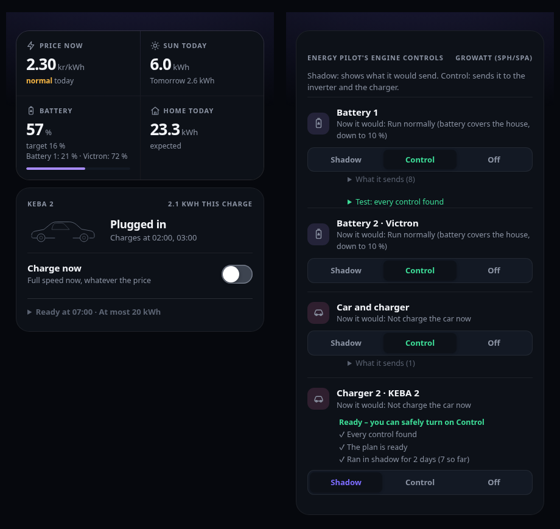

- **No house sensor needed** – it works the house out from your grid, solar, battery and car meters.
- **Any solar forecast** – Solcast, Open-Meteo, Forecast.Solar … or its own from the weather and your panels' history.
- **Odd setups** – several solar arrays are added up, the battery's and grid's sign is found by itself, and a changing
  feed-in price can come from a sensor or your own tariff plan (with a daily cap).
- **Power tariffs** (Belgium, Norway, Sweden) – keeps track of the month's peak and shaves it with the battery.
- **Off-grid** – the generator becomes the "grid": it starts before the battery reaches your reserve, runs in long runs
  and always at the emergency level.
- **Octopus Agile** – the coming prices come from Agile Predict until the real ones are out.
- **Your own AppDaemon in shadow** – runs your existing setup unchanged next to its own engine and shows how often they agree.

## Dashboard cards

Add them from the card picker – search for *Energipilot* – and pick a view: Everything, Energy flow, **Status** (small, for a
phone: what it does now, why and what comes next), Battery (with its level the next 24 hours), Today's plan, The car or
Savings. They follow your Home Assistant theme. The card comes with the companion integration – install it from the
Marketplace (HACS): [energy-pilot-companion](https://github.com/Clahen86/energy-pilot-companion).

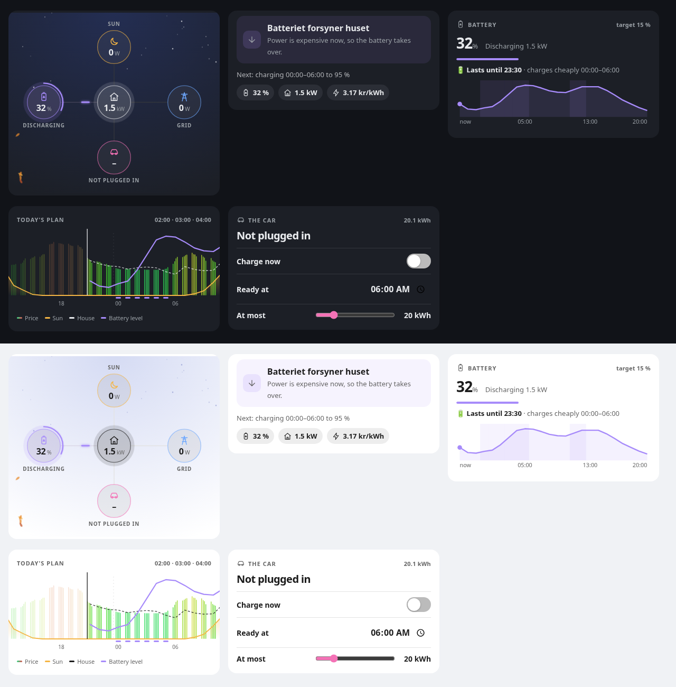

## What you need

| | |
|---|---|
| **Required** | Home Assistant, and a house power sensor (W) – or grid and solar sensors, it works the house out from them |
| **Prices** | Nothing – spot prices for 26 European countries are built in. Strømligning, Nord Pool, Tibber, Octopus, Amber, EDF Tempo and many more are used if you have them. No spot price (USA, UK …)? Enter your tariff plan or start from a template. |
| **Optional** | Solar panels, a home battery, an EV charger – any of them, all of them, or none |

## Brands

Everything goes through the device's own Home Assistant integration. 
✅ runs in real use · 🧪 built from the integration's own code, waiting for a beta tester with the hardware

| | |
|---|---|
| **Inverter / battery** | ✅ Growatt SPH (SPA) · ✅ Victron (ESS) · ✅ Deye (Solarman) · ✅ GoodWe (ET/EH/BT/BH) · ✅ Alpha ESS · ✅ SolaX (SolaX Modbus) · ✅ Deye (ESPHome) · ✅ EcoFlow PowerStream · ✅ Kostal (Modbus control) · 🧪 GoodWe EMS · 🧪 Growatt MIN/MOD TL-XH · 🧪 Growatt (cloud) · 🧪 Sofar (Solarman or SolaX Modbus) · 🧪 Sigenergy · 🧪 Tesla Powerwall · 🧪 Enphase IQ Battery · 🧪 Megarevo · 🧪 Huawei SUN2000/LUNA2000 · 🧪 Sungrow · 🧪 SolarEdge · 🧪 Fox ESS · 🧪 GivEnergy · 🧪 Solis · 🧪 myenergi libbi · 🧪 Marstek Venus · 🧪 Luxpower · 🧪 E3DC · 🧪 GivEnergy (GivTCP) · 🧪 Anker SOLIX (also Anker's own integration) · 🧪 Kostal Plenticore · 🧪 SolaX Gen2/Gen3 · 🧪 Growatt (SolaX Modbus) · 🧪 Off-grid via ESPHome (Growatt SPF, SRNE, Voltronic/MPP) · 🧪 Luxpower/EG4 (MonitorMySolar) · 🧪 Zendure SolarFlow/Hyper · 🧪 EcoFlow PowerOcean (local Modbus) · 🧪 Marstek Venus (local API) · 🧪 Voltronic/Axpert (MQTT, chosen by hand) · any other with a guide: search its controls and pick an option with one tap |
| **EV charger** | ✅ KEBA · ✅ Easee · 🧪 Zaptec · 🧪 go-e · 🧪 Wallbox · 🧪 Peblar · 🧪 OCPP · 🧪 Alfen · 🧪 Ohme · 🧪 myenergi zappi · 🧪 Hypervolt · 🧪 evcc · any with a switch and a current setting |
| **Prices** | ✅ Strømligning · ✅ built-in spot prices · ✅ Octopus Energy (Intelligent Go, Agile Outgoing) · 🧪 Octopus Agile import · 🧪 Nord Pool · 🧪 Tibber · 🧪 Energi Data Service · 🧪 ENTSO-E · 🧪 Amber · 🧪 EDF Tempo · 🧪 EnergyZero · 🧪 easyEnergy · 🧪 Frank Energie · 🧪 Zonneplan · tariff plans |

**SolarEdge (Modbus Multi):** turn on *Power Control Options → Storage Control* in the integration's options – its battery controls only show then. 
**Luxpower/EG4 through MonitorMySolar:** set AC charge and forced discharge window 1 to 00:00–23:59 once – they only run inside their windows. 
**Zendure:** set your P1 meter in the Zendure integration – it only steers when the meter updates. 
**Alpha ESS:** in the AlphaESS app, add one short charge and one short discharge period (e.g. 00:00–00:15) on all weekdays and turn on time-based control. Its integration can only change periods that already exist – Energy Pilot then takes them over and sets the times itself.

## FAQ

<b>Can it run next to the system I use today?</b>

Yes – that's what shadow is for. It never controls a part another system controls, unless you tell it to.

<b>Does it send any data?</b>

Only to the developer, and only what is listed here. Each install has a random id the app makes itself.

- **Learning together** (on unless you turn it off under *Settings*): once a day a small line – version,
  country, which inverter/charger/price source, what your house has, Shadow or Control, savings this month (rounded)
  – plus self-test results, what it mended by itself, and errors in the app. It also sends **how it is set up**, so
  the brand profiles can be fixed: for the inverter, battery and charger the integration, maker and model, which
  entities are used and what for (with your own device name taken out – `select.<device>_export_limiter`), their
  values, and what failed. Never names of people, address, area or your use hour by hour.
- **Share hour by hour and area** (off until you say yes – the front page asks once, and it's under *Settings*):
  yesterday's use, sun, battery level and price hour by hour, and every quarter hour your sun against its forecast and
  whether the grid is down, for an area of about 10 km. In return the sun forecast is corrected by your neighbours'
  sun, you're told when the power is out nearby, and the forecasts get better for everyone. Use hour by hour can tell
  when someone is home – that's why it's your choice.
- **Shared fixes**: when three homes with the same inverter find the same fix in their self-test, it goes to the
  developer first. Only once approved does everyone with that inverter get it – and a shared fix can never turn
  charging into selling or the other way round, or pick a mode that could take the house off the grid.
- **Share my setup** (off unless you turn it on, under *Settings*): the full entity names of the inverter, battery and
  charger are sent too.
- **Get help** – only when you press it, and you see exactly what is sent first: the test result, your settings (no
  passwords), the readings and the plan, plus your note and pictures.

Everything else stays in your home – the ML models run there too. It fetches public data: weather (Open-Meteo), spot
prices (Energi Data Service, energy-charts.info) and exchange rates (ECB).

<b>What if the internet goes down?</b>

It keeps planning with the prices and weather it already has, and your inverter keeps running as normal.

<b>Do I need a battery?</b>

No. With just solar it plans and shows your day. With just a charger it charges the car in the cheapest slots.

<b>Something looks wrong – what do I do?</b>

Run **Test your system** (under Control), then open the **Help** tab – write what's wrong and attach a picture if you
like. No GitHub account needed. You can also *Download diagnostics* there and attach the file to an
[issue](https://github.com/Clahen86/Energy-pilot/issues).

## Good to know

- The 🧪 profiles are not yet tried on real systems – run **Test your system** first, and press *Get help* to send me the result.
- Languages: English, Danish, German, French, Dutch, Swedish and Norwegian – it follows Home Assistant's language.
  Corrections from native speakers are very welcome.

MIT licence.
