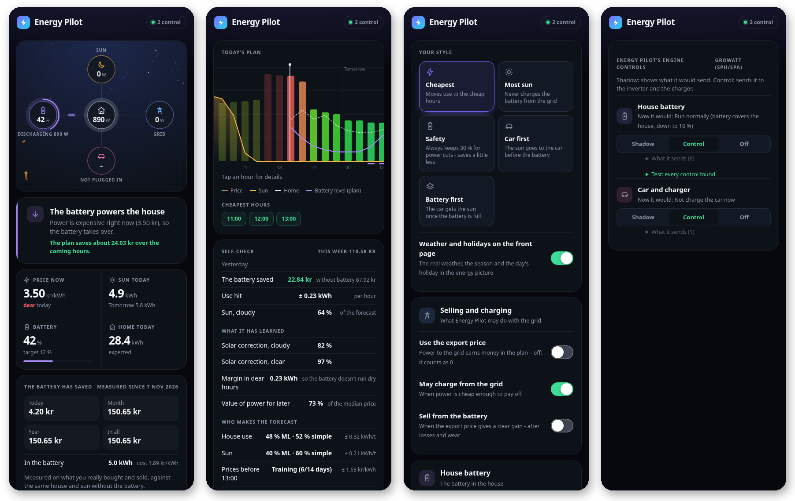
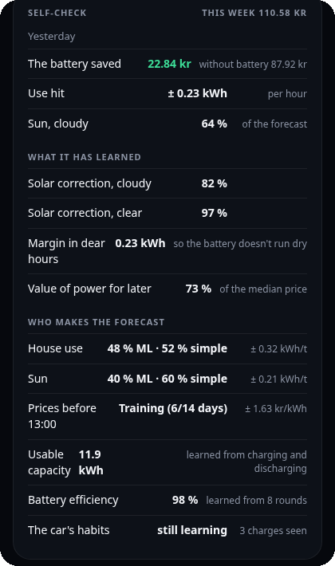
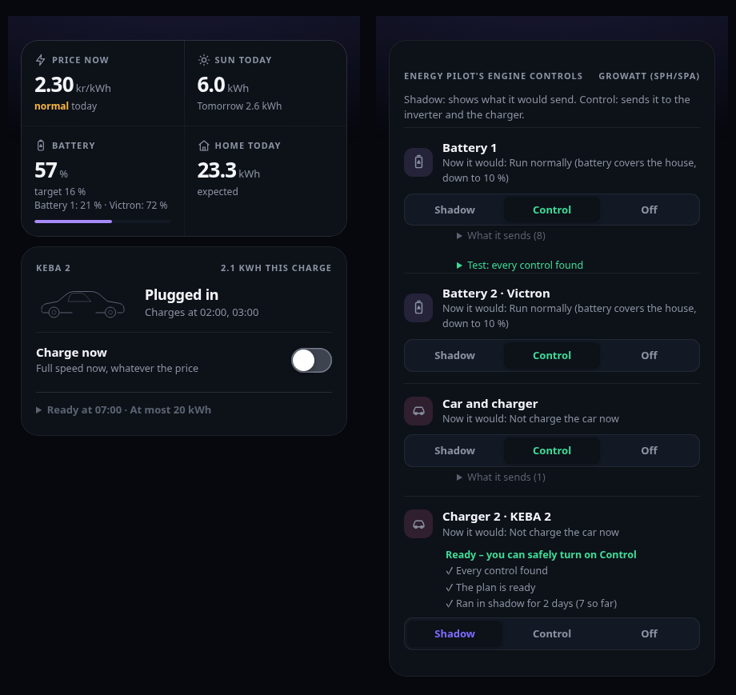

# ⚡ Energy Pilot

**Your home battery, solar panels and electric car – planned for the lowest price.** 
One app for Home Assistant that finds what you have, learns your home and gets better every night.

[Install](#install) · [Features](#features) · [Dashboard cards](#dashboard-cards) · [Brands](#brands) · [FAQ](#faq) · 🇩🇰 [Dansk](README.da.md)

> [!TIP]
> **🧪 Beta testers wanted.** Any setup counts – just a charger, just solar, or battery + solar + car. I especially need
> people with other inverters and chargers than mine. [Open an issue](https://github.com/Clahen86/Energy-pilot/issues)
> and tell me what you have.

## Why Energy Pilot

| | |
|---|---|
| 🔍 **Set up in two minutes** | It finds your solar, battery, grid, house, car and prices by itself. No YAML, no templates. |
| 👻 **Safe from the start** | It always starts in *shadow*: it shows what it would do, but controls nothing until you say so. |
| 🧠 **Learns your home** | A simple forecast from day one, and ML models trained every night on your own data take over when they hit better. |
| ⏱️ **Plans in quarter hours** | Uses the market's own slots (15 min in Europe, 30 min on UK Agile), so the cheapest quarters are used. |
| 💰 **Shows what it saved** | Measured from what you really bought and sold, against the same house and sun without the battery. |
| 🔒 **Stays at home** | Runs on a Raspberry Pi next to Home Assistant. No cloud, no subscription, no telemetry. |

## Install

**Home Assistant OS / Supervised**

1. *Settings → Apps → App store → ⋮ → Repositories* → add `https://github.com/Clahen86/Energy-pilot`
2. Install **Energipilot** and start it. It appears in the sidebar.
3. The guide shows what it found. Fix anything that's wrong and press **Get started**.
4. Restart Home Assistant once. *Energipilot* then appears under *Devices & services* with buttons and sensors.

**Docker (Home Assistant Container/Core):** see [`docker/docker-compose.yml`](docker/docker-compose.yml). Give it your
Home Assistant address and a long-lived access token, and open `http://<host>:8099`.

## How it works

1. **Finds what you have** – and only shows that. No battery? No battery screens.
2. **Makes a plan** for today and tomorrow – when to charge the battery, when to use it, when to charge the car.
3. **Runs in shadow** next to what you use today and shows what it would send to your inverter and charger.
4. **Learns every night** from what really happened.
5. **You switch it on** part by part – battery, car – when you trust it. One tap puts everything back in shadow.

## Features

### 🔋 Home battery
- Charges when power is cheap or the sun gives too much, and covers the house when power is dear.
- **Sells from the battery when it pays** (optional) – after losses, wear and your export limit. It can skip the cheap hours.
- **Battery targets** – "at least 80 % at 7:00", every day.
- **Counts the wear** – finds the battery type (LFP, NMC, sodium, lead) and never cycles it for a few cents.
- **Learns the battery** – its real usable capacity, efficiency and how it slows down near full.
- **Never half a command** – if a control is missing, it doesn't control and tells you what's missing.
- **Keeps its settings in place** – and tells you if Predbat or an automation keeps changing the battery too.

### 🚗 Car and charger
- **Follows the sun** minute by minute (6 A and up) and **never trips the main fuse**.
- **Ready at** a set time, charged in the cheapest slots before it.
- **Two limits** – from the grid up to, say, 80 %, and free solar surplus up to 100 %.
- **The car's own battery %** from its integration (Tesla, Kia/Hyundai, VW group, BMW, Polestar, Volvo …).
- **"100 % for the next trip"** – turns itself off when the car leaves.
- **Never counted twice** – if your house sensor includes the car, it takes it out.

### 🧠 It learns your home

Two ways of forecasting side by side, and the better one decides:

- **From day one:** the average for each hour and weekday from your own history, adjusted for temperature and holidays.
- **As it earns it:** ML models for house use, solar (your panels, direction and shade) and tomorrow's prices before
  they're out. They get no say for the first three weeks, then a share that follows how well they hit. If they start
  to miss – a new heat pump, a new car – their share drops again by itself.
- **Also learned:** the solar forecast's usual error on cloudy and clear days, a safety margin for the dear hours, and
  the car's habits.

### 🏠 Inside Home Assistant
- A sidebar panel in 7 languages, in light and dark – with the real weather, seasons and holidays on the energy picture.
- **Dashboard cards** for the energy flow, battery, car and plan.
- **Sensors** for your own automations: the decision now, next battery charge, next car charge, next sale, **cheapest
  hour** (start the dishwasher then), what the battery saved and what the power in it cost.
- **Buttons and switches:** *Charge now*, *Ready at*, and *Battery/Car control* (Shadow / Control / Off).
- **A settings check** that explains in plain words when a setting spoils the plan, with a one-tap fix.

<b>More – several batteries and chargers, off-grid, power tariffs, odd setups</b>

- **Several home batteries** – a SolarEdge and a Victron, say: planned as one, each controlled through its own inverter
  and put in control on its own.
- **Several chargers** – each car has its own *charge now*, *ready at* and *at most*, and all stay under the main fuse.

  

- **No house sensor needed** – it works the house out from your grid, solar, battery and car meters.
- **Any solar forecast** – Solcast, Open-Meteo, Forecast.Solar … or its own from the weather and your panels' history.
- **Odd setups** – several solar arrays are added up, the battery's and grid's sign is found by itself, and a changing
  feed-in price can come from a sensor or your own tariff plan (with a daily cap).
- **Power tariffs** (Belgium, Norway, Sweden) – keeps track of the month's peak and shaves it with the battery.
- **Off-grid** – the generator becomes the "grid": it starts before the battery reaches your reserve, runs in long runs
  and always at the emergency level.
- **Octopus Agile** – the coming prices come from Agile Predict until the real ones are out.
- **Your own AppDaemon in shadow** – runs your existing setup unchanged next to its own engine and shows how often they agree.

## Dashboard cards

Add them from the card picker – search for *Energipilot*. They follow your Home Assistant theme.

## What you need

| | |
|---|---|
| **Required** | Home Assistant, and a house power sensor (W) – or grid and solar sensors, it works the house out from them |
| **Prices** | Nothing – spot prices for 26 European countries are built in. Strømligning, Nord Pool, Tibber, Octopus, Amber, EDF Tempo and many more are used if you have them. No spot price (USA, UK …)? Enter your tariff plan or start from a template. |
| **Optional** | Solar panels, a home battery, an EV charger – any of them, all of them, or none |

## Brands

Everything goes through the device's own Home Assistant integration. 
✅ runs in real use · 🧪 built from the integration's own code, waiting for a beta tester with the hardware

| | |
|---|---|
| **Inverter / battery** | ✅ Growatt SPH (SPA) · 🧪 Growatt MIN/MOD TL-XH · 🧪 Deye (Solarman or ESPHome) · 🧪 Sofar (Solarman or SolaX Modbus) · 🧪 Sigenergy · 🧪 Tesla Powerwall · 🧪 Enphase IQ Battery · 🧪 Victron (ESS) · 🧪 EcoFlow PowerStream · 🧪 Megarevo · 🧪 Huawei SUN2000/LUNA2000 · 🧪 SolaX · 🧪 Sungrow · 🧪 SolarEdge · 🧪 Fox ESS · 🧪 GivEnergy · 🧪 Solis · 🧪 Alpha ESS · any other by picking its controls yourself |
| **EV charger** | ✅ KEBA · 🧪 Easee · 🧪 Zaptec · 🧪 go-e · 🧪 Wallbox · 🧪 Peblar · 🧪 OCPP · 🧪 Alfen · 🧪 Ohme · 🧪 myenergi zappi · any with a switch and a current setting |
| **Prices** | ✅ Strømligning · ✅ built-in spot prices · 🧪 Nord Pool · 🧪 Tibber · 🧪 Energi Data Service · 🧪 ENTSO-E · 🧪 Octopus Energy (Agile, export) · 🧪 Amber · 🧪 EDF Tempo · 🧪 EnergyZero · 🧪 easyEnergy · 🧪 Frank Energie · 🧪 Zonneplan · tariff plans |

## FAQ

<b>Can it run next to the system I use today?</b>

Yes – that's what shadow is for. It never controls a part another system controls, unless you tell it to.

<b>Does it send any data?</b>

No. Everything runs in your home, the ML models too. It only fetches public data: weather (Open-Meteo), spot prices
(Energi Data Service, energy-charts.info) and exchange rates (ECB).

<b>What if the internet goes down?</b>

It keeps planning with the prices and weather it already has, and your inverter keeps running as normal.

<b>Do I need a battery?</b>

No. With just solar it plans and shows your day. With just a charger it charges the car in the cheapest slots.

<b>Something looks wrong – what do I send?</b>

Press *Download diagnostics* under Settings and attach the file to an
[issue](https://github.com/Clahen86/Energy-pilot/issues). It holds no passwords.

## Good to know

- The 🧪 profiles are not yet tried on real systems – run them in shadow first, check the control test, and tell me how it goes.
- Languages: English, Danish, German, French, Dutch, Swedish and Norwegian – it follows Home Assistant's language.
  Corrections from native speakers are very welcome.

MIT licence.
